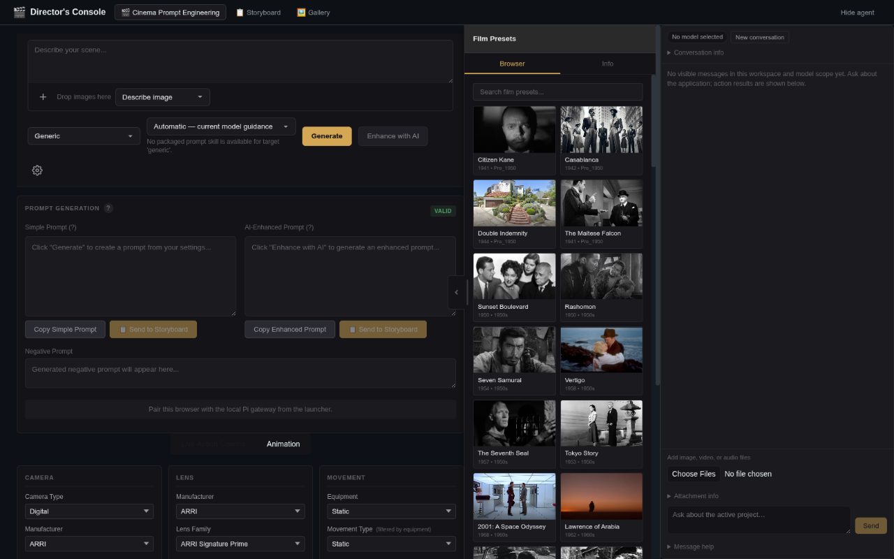
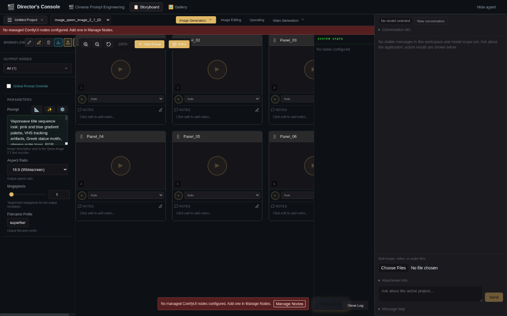
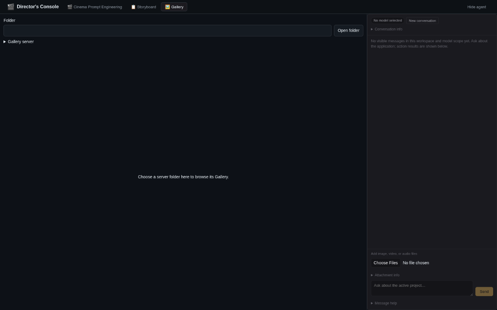

# Director's Console

**Design the shot. Run the workflow. Keep the results together.**

Director's Console brings cinematic prompt design, ComfyUI image and video workflows, and media management into one workspace. Cinema Prompt Engineering, Storyboard (the Director Console), and Gallery are independent applications that can exchange prompts and media. An embedded agent can work across them from any tab; using Console or Gallery does not require a Prompt Engineer handoff.

*Project Eliot*


*Existing panel overview: per-shot panels, parameters, reference inputs, and node selection are shown; the latest controls are documented in the [Storyboard guide](docs/storyboard.md).*

<!-- moeffect-demo:start -->
## Demo

Watch the landscape demonstration below.

https://github.com/user-attachments/assets/b5335be3-3095-4ab9-a2e6-4dabb0632e14

[Watch on the website and read more about the tool](https://moeffect.gr/index.php/tools/directors-console/).

<!-- moeffect-demo:end -->

## Table of Contents

- [Why Director's Console](#why-directors-console)
- [Cinema Prompt Engineering](#cinema-prompt-engineering)
- [Storyboard](#storyboard)
- [Gallery](#gallery)
- [Embedded Agent](#embedded-agent)
- [Installation and Quick Start](#installation-and-quick-start)
- [AI LLM Provider Setup](#ai-llm-provider-setup)
- [Architecture](#architecture)
- [Documentation](#documentation)
- [Changelog](#changelog)
- [Security & Deployment](#security--deployment)

## Why Director's Console

- **Cinematic defaults** — Start from grounded camera, lens, lighting, movement, and style choices.
- **Image-aware enhancement** — Start from text, an attached image, or both; use a vision-capable LLM when images are attached.
- **Workflow-based generation** — Use ComfyUI workflows for generation, editing, upscaling, and video.
- **Per-shot control** — Keep panel-specific parameters, versions, notes, and history together.
- **Parallel rendering** — Select multiple ComfyUI nodes and follow progress for each job.
- **Project media organization** — Browse, rate, tag, rename, compare, trash, and hand off project files.
- **Embedded agent** — Choose Pi or Codex with an exact model and thinking level, reuse the installed harness login, and chat beside any application.

## Cinema Prompt Engineering

CPE is the text and configuration side of the application. Select Live-Action Cinema or Animation, use a preset or configure fields directly, and choose a target prompt profile. The **+** picker, drag-and-drop composer, and image previews support text-only, image-only, or text-plus-image enhancement.

**Generate** creates rule-based text from the current configuration. **Enhance with AI** sends the selected LLM the attached pixels when applicable, plus the full current configuration and selected preset/style context; choose **Describe image**, **Use as reference**, or **Use as starting image**, with model-specific variants where supported. CPE does not render.


*Film preset browser beside the configuration experience: camera, lens, lighting, and preset choices guide the brief. See the [Cinema guide](docs/cinema.md) for current controls and boundaries.*

**Guides:** [Cinema Prompt Engineering](docs/cinema.md) · [Cinema presets](docs/cinema-presets.md) · [Cinematography reference](docs/cinematography-reference.md) · [Enhancement profiles](Documentation/PROMPT_ENHANCEMENT_PROFILES.md)

## Storyboard

Storyboard is the execution workspace. Import or select a ComfyUI workflow, expose its supported controls, assign per-shot parameters, add image/video inputs where the workflow allows them, and send the workflow directly to one or parallel ComfyUI render nodes.

Actual generation depends on the selected workflow, installed weights, and custom nodes. The frontend uses ComfyUI REST and WebSocket APIs directly for execution. Console prompt enhancement uses its own generation target and task context; it does not depend on Prompt Engineer settings. Agent attachments can provide actual images or sampled video frames to a compatible harness model.

**Guide:** [Storyboard](docs/storyboard.md) · [Multi-node generation](docs/MULTI_NODE_GENERATION.md)

## Gallery

Gallery is the project media tab beside Cinema and Storyboard. Use grid, list, or borderless masonry views, with timeline grouping for chronological browsing. Filter, compare, rename, rate, tag, search metadata, move files, and use trash/restore without leaving the project.

Gallery can send a reference to an exposed Storyboard input or restore compatible workflow metadata from a PNG. That handoff prepares a workflow input; the selected workflow still determines what can be submitted.

Gallery selects its own folder and server and can be used without opening a Console project.

**Guide:** [Gallery](docs/gallery.md)

## Embedded Agent

Open **Settings → Agent harness and model**, choose **Pi** or **Codex**, refresh the authenticated inventory, select the model and optional thinking level, and save. Harness models write prompts and operate the application; the media generation target remains a separate choice.

The launcher uses installed harness authentication. Pi reads its normal agent profile; Codex uses the existing `CODEX_HOME` or `~/.codex` by default. No account credentials are copied into Director's Console. Native Codex `0.166.0` is currently required. See [agent setup and limits](docs/agents.md).

- Ask for an outcome: create an image at a requested resolution, crop an attachment, or animate an image. The agent can inspect configured backends, use curated recipes, or propose a custom workflow, save and attach it, set exposed controls, and run it.
- Ask for cinematic constraints explicitly when you want them. Ordinary Console prompts and Gallery work remain independent of Prompt Engineer.
- Expand **Thinking** inside a reply or **Application actions** to inspect progress. Conversation, attachment, and message-help text is collapsed by default; **New conversation** starts a fresh harness session.

### Current interface

These captures show the current layout in an unpaired standby browser: no agent model is selected, Gallery has no folder open, and Console has no managed render nodes. They demonstrate the interface, not a completed agent run.







Pi has documented manual workflow, render, media, and project-operation evidence. Codex installed-login discovery is verified; authenticated application turns and restart recovery remain outstanding. Audio attachments are metadata-only, and video perception uses sampled frames. See the [verification report](docs/plans/agent-integration-live-status-2026-11-06.md) for the distinction between implementation and live acceptance.

## A typical shot

1. Open **Cinema Prompt Engineering**, choose a discipline and preset, then tune the brief.
2. Use **Generate** for deterministic rule-based text, or attach an image and choose **Enhance with AI** when a configured vision-capable LLM is available.
3. Send the chosen prompt to **Storyboard**, select a workflow, and confirm the panel's exposed parameters and image inputs.
4. Choose one or more render nodes and generate. Outputs remain in the panel history and can be reviewed or organized in **Gallery**.

## Installation and Quick Start

### Requirements

- Python 3.11+
- Node.js 22.13+ (22.x) or 24+, with npm
- For the optional agent gateway: Node.js 22.19+ on the 22.x line, or 24+
- Git
- Windows, macOS, or Linux
- For rendering: a running ComfyUI node with the selected workflow's models and custom nodes. Prompt authoring does not require a render node.

### Launch

```bash
git clone https://github.com/NickPittas/DirectorsConsole.git
cd DirectorsConsole
python start.py --setup
python start.py
```

`--setup` provisions the launcher's per-service environments and exits; it does not boot all services. The launcher then provides:

| Service | Address | Role |
| --- | --- | --- |
| Frontend | http://localhost:5173 | Director's Console UI |
| CPE backend | http://localhost:9800 | Rules and prompt API |
| Orchestrator | http://localhost:9820 | Project, file, Gallery, and job-group operations |
| Agent gateway | http://127.0.0.1:9810 | Paired local harness sessions and application actions |

Optional flags: `python start.py --no-browser`, `python start.py --no-orchestrator`, and `python start.py --no-frontend`.

For manual setup, development commands, and regression checks, see [Contributing](docs/contributing.md). After launch, open the frontend and configure a project destination before saving generated media. Add ComfyUI node URLs in Storyboard only when you are ready to render. Provider configuration is similarly optional unless you use Enhance with AI.

## AI LLM Provider Setup

Rule-based Cinema prompts need no LLM account. Use the shared Pi/Codex harness selection for agent chat and enhancement, or explicitly select **Use legacy direct provider** for the older provider path. The legacy OpenAI Codex OAuth provider is separate from the installed Codex harness. A model catalog or connection does not prove generation access or vision availability.

### Google AI (Gemini) API key setup

Use the **Google AI (Gemini)** provider with a Google AI Studio API key. This is distinct from Antigravity OAuth; never put a real key in source, logs, or frontend `VITE_*` variables. See the [Google AI setup details](docs/providers.md#google-ai-gemini-api-key).

### Antigravity OAuth app configuration

Antigravity uses authorized OAuth application credentials in the private backend `CinemaPromptEngineering/.env`, not frontend variables. Never commit client secrets or tokens. See the [Antigravity configuration details](docs/providers.md#antigravity-application-configuration).

See the complete [provider guide](docs/providers.md) for compatible endpoints, local servers, credentials, and verification boundaries.

## Architecture

- **Frontend:** calls selected ComfyUI nodes directly through REST/WebSocket for workflow generation.
- **CPE API:** provides cinematography rules, configuration, and optional LLM enhancement.
- **Orchestrator:** handles project/file operations, Gallery services, backend status, and job groups.
- **Agent gateway:** pairs with the local browser, streams harness replies and activity over HTTP/SSE, and dispatches typed application actions. ComfyUI generation still goes directly from the frontend to the selected backend.

See [Multi-node generation](docs/MULTI_NODE_GENERATION.md) and the [architecture details in the guides](docs/storyboard.md).

## Documentation

| Topic | Guide |
| --- | --- |
| Cinema | [docs/cinema.md](docs/cinema.md) |
| Storyboard | [docs/storyboard.md](docs/storyboard.md) |
| Gallery | [docs/gallery.md](docs/gallery.md) |
| Agents and harness setup | [docs/agents.md](docs/agents.md) |
| Providers | [docs/providers.md](docs/providers.md) |
| Presets | [docs/cinema-presets.md](docs/cinema-presets.md) |
| Technical reference | [docs/cinematography-reference.md](docs/cinematography-reference.md) |
| Enhancement profiles | [Documentation/PROMPT_ENHANCEMENT_PROFILES.md](Documentation/PROMPT_ENHANCEMENT_PROFILES.md) |
| Multi-node rendering | [docs/MULTI_NODE_GENERATION.md](docs/MULTI_NODE_GENERATION.md) |
| Development | [docs/contributing.md](docs/contributing.md) |
| Recovery | [docs/session-recovery.md](docs/session-recovery.md) |

## Changelog

### 2026-11-06 — Embedded agents and independent application control

- Added Pi/Codex harness selection, installed-login reuse, shared chat beside all three tabs, attachments, inline expandable thinking, collapsed help, and fresh-session creation.
- Added scoped application actions, workflow proposal/recipe preparation, backend inspection, revision-aware workflow saves, and a durable generation journal that does not automatically retry ambiguous submissions.
- Kept Console enhancement and Gallery folder selection independent of Prompt Engineer; cinematic constraints are optional and explicit.
- Fixed model-catalog browser preflight and native Codex discovery through `mise` shims.

Pi has manual acceptance evidence; Codex login/catalog discovery is verified, with autonomous application execution still pending. See [release notes](CHANGELOG.md) and [current verification status](docs/plans/agent-integration-live-status-2026-11-06.md).

### 2026-10-02 — Image-aware composer and provider handling

- Added image attachments, description/reference/starting-image modes, and model-specific variants for AI prompt enhancement.
- Preserved complete configuration and preset/style context; improved compatible endpoints, model discovery, OAuth, and provider responses.
- Reorganized this README around the three tabs, with focused guides for panels, providers, presets, and technical reference.

Offline implementation checks passed. Live provider, browser, and render verification remains pending; see the [verification details](Documentation/PROMPT_ENHANCEMENT_PROFILES.md#verification).

### 2026-09-19 — Prompting and UI maintenance

Added workflow categories, expanded image guides, Gallery layout work, and translated-DOM control hardening.

See [CHANGELOG.md](CHANGELOG.md) for the full history.

## Security & Deployment

Director's Console has no application-wide authentication or authorization. Use it only on a trusted, private, access-controlled network; it is not a hardened public service and has not undergone a formal security audit. Protect provider credentials, browser profiles, backend data, workflows, media, and connected ComfyUI nodes. Treat project files and workflows as untrusted input.

See the [provider security details](docs/providers.md) and the [contributing guide](docs/contributing.md) for operational boundaries.

## License

Released under the [MIT License](LICENSE).
