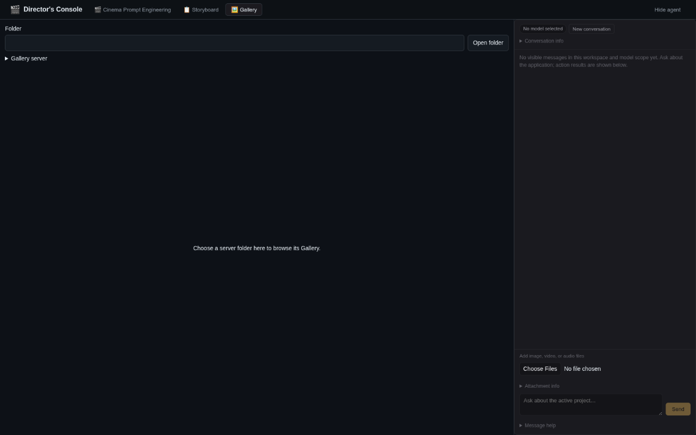

# Gallery

[← Back to the README](../README.md)

Gallery browses images and videos from its own selected server and folder. Open
the **Gallery** tab beside Cinema and Storyboard, enter the root folder and click
**Open folder**, then browse its folder tree. Gallery works without selecting a Console
project; its metadata remains stored per project folder.

## Browse media

Use the toolbar to switch between:

- **Grid** — bounded thumbnails for fast browsing.
- **List** — a metadata-oriented table.
- **Borderless Masonry** — Pinterest-style cards that preserve natural aspect
  ratios.

**Timeline** is a grouping/toggle for chronological browsing, not a fourth
layout. Use sorting, thumbnail size, and the filter bar to narrow the current
folder by image/video type, rating, tags, or date. Star ratings are 1–5, and
custom color tags can be assigned to files. Saved views preserve a useful
combination of folder state, layout, sorting, and filters.

Double-click media for the full-size lightbox. Select two files for Compare; when more are selected, it compares the first
pair. Video previews include playback controls; hover preview and
metadata/info are available from the file actions.

## File operations

Select one or more files, then use the context menu or selection actions:

- **Rename** one file, or use **Batch Rename** with templates and optional
  regular-expression find/replace. Preview the result before applying it.
- **Move to...** an existing folder, or **Move to New Folder...** to create a
  folder and move the selection in one step.
- Search PNG metadata for prompts, models, samplers, seeds, and other embedded
  ComfyUI information.
- Scan for duplicate files by content hash, then inspect candidates in Compare.

The Gallery stores ratings, tags, and saved views per project. Its metadata
file is `.gallery/gallery.json` inside the project folder. This JSON design is
intended to work with NAS/CIFS project storage.

## Trash

**Move to Trash** soft-deletes selected files into `.gallery/.trash/`. Open the
Trash view to select files and **Restore** them to their original locations.
**Empty Trash** permanently deletes the trash contents; use it only when those
files are no longer needed.

## Send media to Storyboard

This optional reference-to-generation handoff is useful when you want to use a
Gallery file as a Storyboard workflow input:

1. Select the project folder and choose an image or video.
2. Open its context menu and choose **Send to Storyboard**.
3. Choose the appropriate exposed workflow input (the submenu shows the
   available image/video inputs).
4. Switch to Storyboard, confirm the reference is on the intended panel, and
   choose **Generate**.

For a PNG, **Use Workflow from Metadata** restores its recorded workflow and
parameters in Storyboard. Gallery batch renames also update matching
Storyboard panel image references. The handoff sets a Storyboard input; it
does not claim that source pixels are sent to an LLM, nor that every model or
workflow supports every input type.

## Embedded agent

One Pi/Codex chat is shared across tabs; its model is separate from generation
targets. Gallery selects its own server/folder and needs no Console project or
Prompt Engineer handoff. Ask the agent to inspect media or recipes, propose,
create, or modify workflows, save/attach them, expose controls, run jobs, and
inspect results. Backend models/custom nodes must be installed; the agent
cannot install them. This is not full manual-feature parity. Pi has manual
workflow/render/media-inspection evidence; Gallery mutations are unverified.
Codex is catalog/login discovery only, with no accepted render.

Chat images send pixels to compatible models; video uses up to three sampled
frames, audio metadata only, and the shared media library is in memory.
**Thinking** is inline in collapsed replies; **Application actions** are
collapsed, with no raw-arguments panel. **New conversation** starts a session,
not a project reset.

*Fresh unpaired standby: no model selected or folder open; layout only, no generated result.*

See [agent setup and limits](agents.md) and the [current verification
report](plans/agent-integration-live-status-2026-11-06.md).

See [Cinema](cinema.md) for enhancement-versus-render guidance and
[Storyboard](storyboard.md) for workflow and generation guidance. For safe
local deployment, see [Security and deployment](../README.md#security--deployment).
